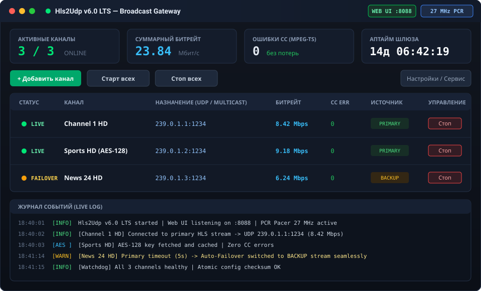

# Hls2Udp v6.0 LTS

Высокопроизводительный вещательный шлюз **HLS → UDP / Multicast** на языке Rust с точным 27 МГц MPEG-TS PCR-пейсингом, автоматическим резервированием потоков, встроенным веб-интерфейсом и нативным десктопным GUI в стиле **Dark Broadcast**.



## Ключевые возможности

- **Точный MPEG-TS PCR Pacer (27 МГц)** — равномерная отправка TS-пакетов по меткам времени PCR с защитой от джиттера и контролем счётчиков непрерывности (CC Errors).
- **Шифрование AES-128** — нативная расшифровка защищённых HLS-сегментов с кешированием ключей.
- **Auto-Failover (резервирование)** — автоматическое переключение на резервный источник при обрыве, таймауте или ошибках декодирования, с плавным возвратом на основной поток.
- **Watchdog и автовосстановление** — контроль замирания потока, экспоненциальная задержка переподключения и автоматический перезапуск воркеров.
- **Нативный GUI (Dark Broadcast)** — минимальное потребление CPU/RAM (`eframe`/`egui`), отображение битрейта, CC-ошибок, аптайма и живого лога в реальном времени.
- **Встроенный Web UI и REST API** — удалённый мониторинг и управление каналами через браузер на порту `8088`.
- **Системный трей и служба Windows** — динамический LED-индикатор состояния в трее, защита от повторного запуска (Win32 Mutex) и поддержка запуска в режиме Windows Service.
- **Атомарное сохранение конфигурации** — безопасная запись настроек без риска повреждения файла при сбое питания.

## Быстрый старт

### Скачать готовый релиз

Перейдите на вкладку **Releases** репозитория и скачайте сборку для вашей ОС:

- **Windows (x64):** `Hls2Udp_v6_0_windows_x64.exe` — автономный исполняемый файл со встроенной иконкой, не требует установки .NET или дополнительных библиотек.
- **macOS (Apple Silicon / arm64):** `Hls2Udp_v6_0_macos_arm64.zip` — распакуйте архив и запустите бинарный файл `Hls2Udp`.

> При первом запуске на macOS может потребоваться разрешить запуск неподписанного приложения в *Системные настройки → Конфиденциальность и безопасность*.

### Первый запуск

1. Запустите `Hls2Udp`.
2. Добавьте канал: укажите название, основной HLS-адрес (`.m3u8`), при необходимости резервный адрес и назначение UDP / Multicast (например, `239.0.1.1:1234`).
3. Нажмите **Старт** — индикатор канала перейдёт в зелёный статус, отобразится текущий битрейт и счётчик CC-ошибок.
4. Для удалённого мониторинга и управления откройте веб-интерфейс в браузере на порту `8088` (`localhost:8088`).

## Режимы работы (Windows)

- **Обычный режим (GUI):** двойной клик по `Hls2Udp.exe` запускает окно управления и иконку в системном трее.
- **Режим службы Windows:** используйте скрипт `Build-And-Install_v6_0.bat` для установки и управления системной службой.

## Сборка из исходного кода

Требуется установленный инструментарий Rust (edition 2021).

### Нативная сборка (macOS / Linux / Windows)

```bash
cargo build --release
```

Готовый бинарный файл будет находиться в `target/release/Hls2Udp` (или `Hls2Udp.exe` на Windows).

### Кросс-компиляция под Windows x64 с macOS

```bash
./build_windows.sh
```

Скрипт использует `cargo-zigbuild` и цель `x86_64-pc-windows-gnu`, автоматически встраивая иконку приложения (`.rsrc`) в итоговый PE32+ файл.

### Запуск тестов

```bash
cargo test
```

## Структура проекта

```text
src/
├── main.rs      # Точка входа, CLI-флаги, защита от двойного запуска
├── config.rs    # Конфигурация каналов, валидация, атомарное сохранение
├── manager.rs   # Менеджер каналов, запуск/остановка воркеров
├── worker.rs    # HLS-клиент, AES-128, Auto-Failover, Watchdog
├── ts.rs        # MPEG-TS парсер, 27 МГц PCR-пейсер, анализатор CC-ошибок
├── gui.rs       # Нативный интерфейс Dark Broadcast (eframe / egui)
├── http.rs      # Встроенный HTTP-сервер, REST API и Web UI
├── ui.html      # Одностраничный веб-интерфейс мониторинга
├── tray.rs      # Иконка системного трея с динамическим LED-индикатором
├── service.rs   # Интеграция со службами Windows (Windows Service)
├── logger.rs    # Кольцевой буфер логов для GUI и Web UI
└── icon.rs      # Встроенные графические ресурсы приложения
```

## Лицензия

Проект распространяется под лицензией [MIT](LICENSE).
